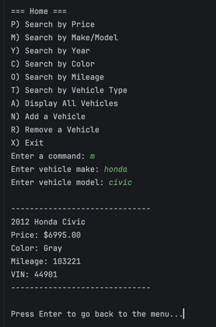

# Car Dealership

A command-line app that allows user to search through a car dealership's inventory by various filters, as well as the feature to add and remove cars from inventory.

## Features

- Pick any car by its features (i.e. make/model, year, price, etc....)
- Add or remove cars from inventory
- Display car info if search matches cars.

## How to run it

1. Open the project in IntelliJ
2. Run `Program.java`
3. Input command like P, M, Y, C
4. Follow questions to find desired car!

## Interesting code

This code is used for saving the updated inventory to the csv file. Its neat how instead of appending it to the file, it will overwrite the contents. This means if you remove a car from the list it will correctly save to csv file now!

```java
    public void saveDealership(Dealership dealership) {
    try {
        BufferedWriter writer = new BufferedWriter(new FileWriter("inventory.csv"));
        writer.write(dealership.getName() + "|" + dealership.getAddress() + "|" + dealership.getPhone() + "\n");
        for (Vehicle vehicle : dealership.getAllVehicles()) {
            writer.write(vehicle.getVin() + "|" + vehicle.getYear() + "|" + vehicle.getMake() + "|" + vehicle.getModel() + "|" + vehicle.getVehicleType()
                    + "|" + vehicle.getColor() + "|" + vehicle.getOdometer() + "|" + vehicle.getPrice() + "\n");
        }
        writer.close();
    } catch (IOException e) {
        System.out.println("Error! Inventory could not be saved.");
    }
}
```

## Screenshot



Made by JohnPaul for the [Java Academy](https://craigmckeachie.github.io/java-academy-docs/).